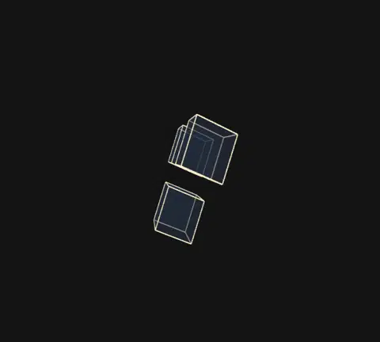
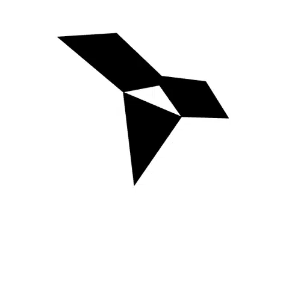
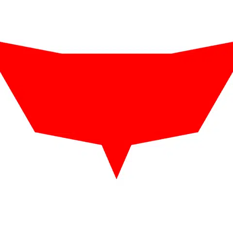
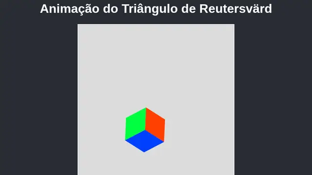
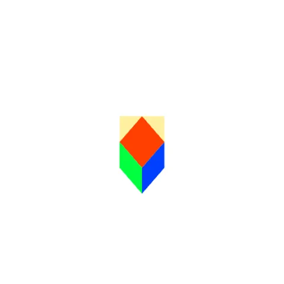
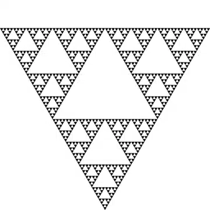
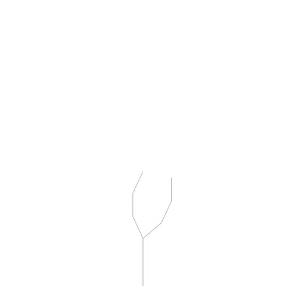
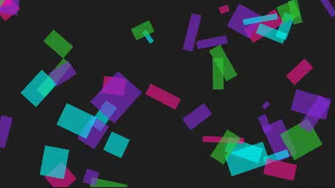

# creative code

**Ilusões de ótica, fractais e arte interativa feitas com código, por Tatiana Barros.**
*Optical illusions, fractals and interactive art made with code, by Tatiana Barros.*

### [▶ Abrir a galeria · Open the gallery](https://tatyquebralayout.github.io/creative-code/)

[🇧🇷 Português](#-português) · [🇺🇸 English](#-english)

---

## 🇧🇷 Português

Oito peças que rodam direto no navegador, feitas em p5.js. Cada uma tem a sua pasta, com o código e um README próprio.

| | Peça | O que acontece |
|---|---|---|
|  | [Reutersvärd 3D](pecas/reutersvard-3d) | O triângulo impossível em 3D, com controle dos eixos X, Y e Z e captura de imagem. |
|  | [Reutersvärd, luz e rotação](pecas/reutersvard-luz) | Você gira a figura e move a luz pra ver a ilusão de outros ângulos. |
|  | [Reutersvärd interativo](pecas/reutersvard-interativo) | Controles de ângulo e tamanho mudam o desenho 2D na hora. |
|  | [Reutersvärd em movimento](pecas/reutersvard-animacao) | O triângulo gira sem fim, e a ilusão nunca se desfaz. |
|  | [Ilusão de Reutersvärd](pecas/reutersvard-ilusao) | A figura clássica, parada, pra olhar com calma. |
|  | [Triângulo de Sierpinski](pecas/sierpinski) | Um fractal que se repete dentro de si mesmo, desenhado por recursão. |
|  | [Árvore fractal](pecas/arvore-fractal) | Uma árvore gerada por regras (L-System) que cresce a cada clique. |
|  | [Neon Convergence](pecas/neon-convergence) | Retângulos neon que se juntam em volta do mouse. |

### Como rodar

Tudo é estático (HTML, CSS e p5.js por CDN). Abra o `index.html` no navegador, ou a pasta de uma peça pra ver só ela. As animações param pra quem ativou "reduzir movimento" no sistema.

### Origem

Estas peças viviam em oito repositórios separados, que agora estão arquivados e apontam pra cá.

---

## 🇺🇸 English

Eight pieces that run straight in the browser, made with p5.js. Each one has its own folder with the code and a README.

| Piece | What happens |
|---|---|
| [Reutersvärd 3D](pecas/reutersvard-3d) | The impossible triangle in 3D, with X, Y and Z controls and image capture. |
| [Reutersvärd, light and rotation](pecas/reutersvard-luz) | Rotate the figure and move the light to see the illusion from other angles. |
| [Interactive Reutersvärd](pecas/reutersvard-interativo) | Angle and size controls reshape the 2D drawing live. |
| [Reutersvärd in motion](pecas/reutersvard-animacao) | The triangle spins forever and the illusion never breaks. |
| [Reutersvärd illusion](pecas/reutersvard-ilusao) | The classic figure, still, to look at slowly. |
| [Sierpinski triangle](pecas/sierpinski) | A fractal that repeats inside itself, drawn by recursion. |
| [Fractal tree](pecas/arvore-fractal) | A tree generated by rules (L-System) that grows with each click. |
| [Neon Convergence](pecas/neon-convergence) | Neon rectangles that gather around the mouse. |

### How to run

Everything is static (HTML, CSS and p5.js from a CDN). Open `index.html` in a browser, or a piece's folder to see just that one. Animations stop for anyone who turned on "reduce motion" in their system.

### Origin

These pieces used to live in eight separate repositories, which are now archived and point here.
