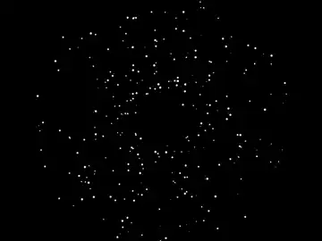
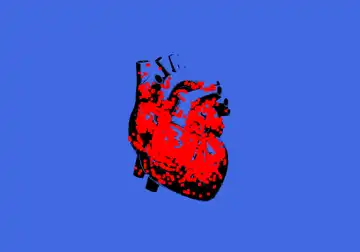
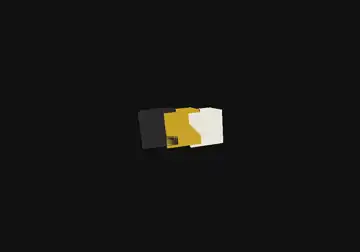
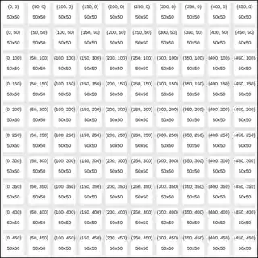

# creative code

**Ilusões de ótica, fractais, 3D e arte interativa feitas com código, por Tatiana Barros.**
*Optical illusions, fractals, 3D and interactive art made with code, by Tatiana Barros.*

### [▶ Abrir a galeria · Open the gallery](https://tatyquebralayout.github.io/creative-code/)

[🇧🇷 Português](#-português) · [🇺🇸 English](#-english)

---

## 🇧🇷 Português

Treze peças que rodam direto no navegador, feitas em p5.js, Canvas e Three.js. Cada uma tem a sua pasta, com o código e um README próprio.

| | Peça | O que acontece |
|---|---|---|
|  | [Reutersvärd 3D](pecas/reutersvard-3d) | O triângulo impossível em 3D, com controle dos eixos X, Y e Z e captura de imagem. |
|  | [Reutersvärd, luz e rotação](pecas/reutersvard-luz) | Você gira a figura e move a luz pra ver a ilusão de outros ângulos. |
|  | [Reutersvärd interativo](pecas/reutersvard-interativo) | Controles de ângulo e tamanho mudam o desenho 2D na hora. |
|  | [Reutersvärd em movimento](pecas/reutersvard-animacao) | O triângulo gira sem fim, e a ilusão nunca se desfaz. |
|  | [Ilusão de Reutersvärd](pecas/reutersvard-ilusao) | A figura clássica, parada, pra olhar com calma. |
|  | [Triângulo de Sierpinski](pecas/sierpinski) | Um fractal que se repete dentro de si mesmo, desenhado por recursão. |
|  | [Árvore fractal](pecas/arvore-fractal) | Uma árvore gerada por regras (L-System) que cresce a cada clique. |
|  | [Neon Convergence](pecas/neon-convergence) | Retângulos neon que se juntam em volta do mouse. |
|  | [Galáxia com zoom](pecas/galaxia-zoom) | Centenas de estrelas giram devagar em volta do centro, e um controle aproxima ou afasta a galáxia. |
|  | [Coração de partículas](pecas/coracao-particulas) | Um coração anatômico claro pulsa enquanto partículas douradas em 3D se soltam dele e voltam. |
|  | [Cubos em Three.js](pecas/cubos-threejs) | Três cubos em grafite, dourado e branco giram, se afastam e voltam a se encaixar, com a câmera circulando em volta. |
|  | [Grid art](pecas/grid-art) | Uma grade vira tela de desenho: você traça com o mouse um pincel neon em quatro cores. |
|  | [Estudos em Canvas](pecas/estudos-canvas) | Três estudos: camadas que trocam com um clique, uma camada que gira ou pulsa, e uma chuva de partículas na cor que você escolher. |

### Como rodar

Tudo é estático (HTML, CSS e JavaScript, com as bibliotecas por CDN). Abra o `index.html` no navegador, ou a pasta de uma peça pra ver só ela. As peças animadas têm um botão redondo de pausar no canto inferior direito, que funciona com mouse e teclado, e a barra de espaço também pausa e retoma. Pra quem ativou "reduzir movimento" no sistema, elas já abrem pausadas, no primeiro quadro, e dá pra tocar a animação quando quiser. O botão vem de [`assets/pausa.js`](assets/pausa.js), um script pequeno compartilhado pelas peças em p5.js, Canvas e Three.js.

### Origem

Oito destas peças viviam em repositórios separados desta conta, que agora estão arquivados e apontam pra cá. As outras cinco vieram de estudos publicados na conta [umataldetatiana](https://github.com/umataldetatiana).

---

## 🇺🇸 English

Thirteen pieces that run straight in the browser, made with p5.js, Canvas and Three.js. Each one has its own folder with the code and a README.

| Piece | What happens |
|---|---|
| [Reutersvärd 3D](pecas/reutersvard-3d) | The impossible triangle in 3D, with X, Y and Z controls and image capture. |
| [Reutersvärd, light and rotation](pecas/reutersvard-luz) | Rotate the figure and move the light to see the illusion from other angles. |
| [Interactive Reutersvärd](pecas/reutersvard-interativo) | Angle and size controls reshape the 2D drawing live. |
| [Reutersvärd in motion](pecas/reutersvard-animacao) | The triangle spins forever and the illusion never breaks. |
| [Reutersvärd illusion](pecas/reutersvard-ilusao) | The classic figure, still, to look at slowly. |
| [Sierpinski triangle](pecas/sierpinski) | A fractal that repeats inside itself, drawn by recursion. |
| [Fractal tree](pecas/arvore-fractal) | A tree generated by rules (L-System) that grows with each click. |
| [Neon Convergence](pecas/neon-convergence) | Neon rectangles that gather around the mouse. |
| [Galaxy zoom](pecas/galaxia-zoom) | Hundreds of stars slowly circle the center, and a slider zooms the galaxy in or out. |
| [Particle heart](pecas/coracao-particulas) | A light anatomical heart beats while golden 3D particles break away from it and return. |
| [Three.js cubes](pecas/cubos-threejs) | Three cubes in graphite, gold and white spin, drift apart and click back together while the camera circles around them. |
| [Grid art](pecas/grid-art) | A grid becomes a canvas: draw with the mouse using a neon brush in four colors. |
| [Canvas studies](pecas/estudos-canvas) | Three studies: layers that swap on click, a layer that spins or pulses, and a particle rain in the color you pick. |

### How to run

Everything is static (HTML, CSS and JavaScript, with libraries from a CDN). Open `index.html` in a browser, or a piece's folder to see just that one. Animated pieces have a round pause button in the bottom-right corner, usable with mouse and keyboard, and the Space bar also pauses and resumes. If "reduce motion" is on in your system, they open paused on the first frame and you can play the animation whenever you like. The button comes from [`assets/pausa.js`](assets/pausa.js), a small script shared by the p5.js, Canvas and Three.js pieces.

### Origin

Eight of these pieces used to live in separate repositories on this account, now archived and pointing here. The other five come from studies published on the [umataldetatiana](https://github.com/umataldetatiana) account.
